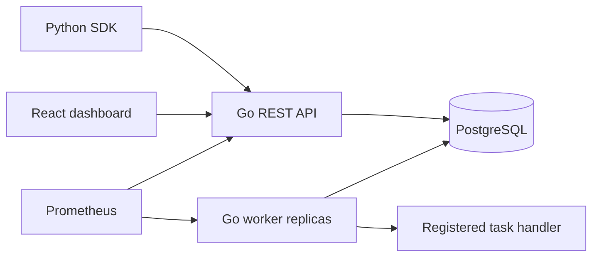

# JobFlow architecture

JobFlow uses PostgreSQL as its queue and durable store. The API submits and manages jobs. Independent workers coordinate through database transactions and execute registered task handlers.

## From submission to outcome

1. The API validates the request and commits the job, along with any idempotency key, before returning HTTP 202. A compatible repeat with the same key returns the original job ID.
2. PostgreSQL time determines eligibility. A free worker slot selects an eligible row with `FOR UPDATE SKIP LOCKED`. The transaction records ownership and a new fencing token and inserts the attempt before releasing the row lock.
3. The worker runs the handler outside the claim transaction. It renews the lease separately and passes a cooperative cancellation and timeout context to the handler.
4. Outcome persistence locks the job first, checks the current lease and fencing token, and updates the job and attempt atomically. A pending cancellation takes precedence over a handler result.
5. A live worker can resolve expired leases. Recovery closes the old attempt and either schedules a retry, moves the job to the dead-letter state, or settles a cancellation. A reclaimed job has a new fencing token when it is claimed again.

## Design decisions

| Decision | Consequence |
| --- | --- |
| PostgreSQL owns job state, eligibility, and coordination | The job, attempt history, and idempotency key can commit together where required. Submission, claims, and recovery all depend on database availability and capacity. |
| A fixed number of slots per worker | Each slot holds one attempt until the outcome is persisted. A noncooperative handler can occupy its slot until it returns or the worker is replaced. |
| Renewable leases and monotonically increasing fencing tokens | Another worker can recover abandoned work, and an old attempt cannot overwrite a newer outcome. Recovery can wait for a held row lock. |
| At-least-once execution within the retry budget | External effects can repeat. Use the job ID as a stable operation key or apply external fencing in the handler. |
| Worker heartbeats and operational metrics | Heartbeats show process freshness. PostgreSQL lease state establishes ownership. Worker metric counters are process-local and durable job history remains available across restarts. |
| Explicit migrations | The deployment controls the schema version. Stop incompatible binaries before migration and preserve a backup for rollback. |

See the [reliability contracts](operations.md#reliability-contracts) for defaults and failure behavior, and the [benchmark procedure](benchmarks.md) for the measured workload.
