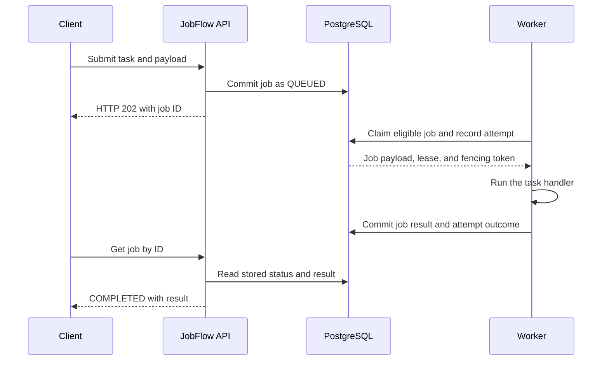
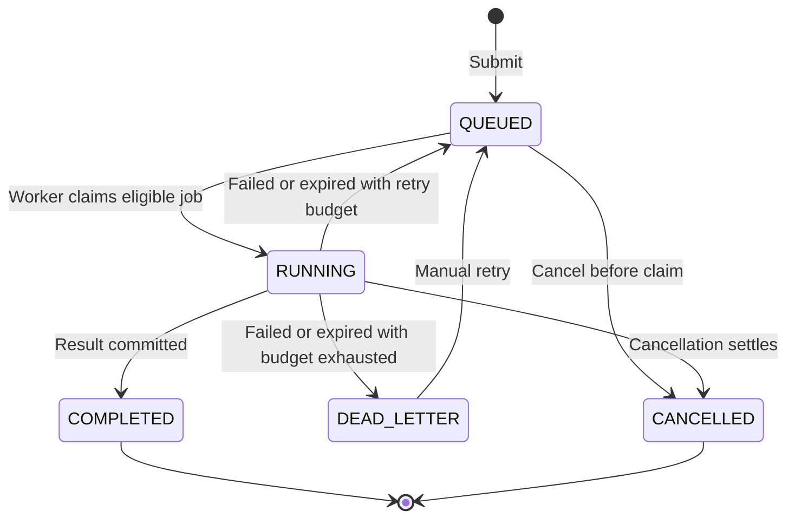
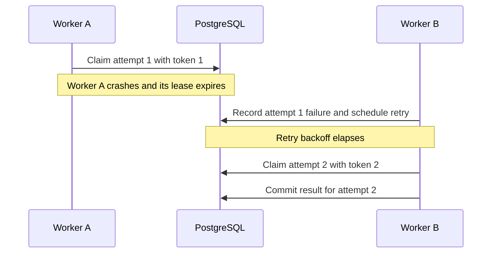

# How JobFlow works

A JobFlow **job** is a stored request to run a task. An **attempt** is one execution of that job by a worker. A job keeps its ID across retries, and each attempt has its own worker, timestamps, and outcome. Start the local stack before running the examples. [Quickstart](../README.md#quickstart)

## From submission to result

The REST API accepts requests from clients such as the Python SDK and the dashboard. PostgreSQL stores the queue, job status, and attempt history. Workers poll PostgreSQL for eligible jobs when they have a free execution slot.



A worker claims a job in a short transaction. Workers skip rows currently locked by another claim, so they can pick different jobs concurrently. The worker releases the database lock before running the handler and renews its lease while it executes. When the handler finishes, the worker saves the job and attempt outcomes together.

## What the job statuses mean



A scheduled job and a job waiting for retry backoff both appear as `QUEUED`. Look at `next_run_at` for the earliest time a worker can claim the job. A manual retry starts a fresh retry cycle and keeps the same job ID and prior attempts. Cancelling a running job records a request. The worker signals the handler through its Go context, and the owning attempt or lease recovery settles the cancellation. [API reference](api.md)

## How a job survives a worker crash

A **lease** is a time-limited claim on a running job. A **fencing token** is a number that increases each time a worker claims the job. A worker must have the current token and an unexpired lease to write an outcome.



This example assumes the job has a retry left. If its budget is exhausted, recovery moves it to `DEAD_LETTER`. If Worker A had stalled and later resumed, JobFlow would reject an outcome written with token 1. The handler might still have performed an external side effect before losing its lease. Use the stable job ID to deduplicate effects that can be repeated. [Reliability contracts](operations.md#reliability-contracts) · [Architecture details](architecture.md)

## Run a job from Python and inspect its attempt

Install the SDK, then run this example against the local API. [SDK setup](../README.md#python-sdk)

```python
from jobflow import Client

with Client("http://localhost:8080") as client:
    options = {"idempotency_key": "walkthrough-addition-42", "max_retries": 1}

    first = client.submit("add_numbers", {"a": 20, "b": 22}, **options)
    repeated = client.submit("add_numbers", {"a": 20, "b": 22}, **options)

    job_id = first["job_id"]
    assert repeated["job_id"] == job_id

    job = client.wait(job_id)
    print(job["status"], job.get("result"))
    print([attempt["status"] for attempt in client.attempts(job_id)["attempts"]])
```

The normal output is `COMPLETED {'sum': 42}` followed by `['COMPLETED']`. Both submissions refer to one stored job because they use the same key and inputs. Use a different key when submitting a new logical job.

## Schedule a job and cancel it before it runs

Use Python 3 to compute a timestamp ten minutes in the future, then submit the job with `curl`.

```sh
RUN_AT=$(python3 -c '
from datetime import datetime, timedelta, timezone
run_at = datetime.now(timezone.utc) + timedelta(minutes=10)
print(run_at.isoformat(timespec="seconds"))
')

curl -fsS http://localhost:8080/api/v1/jobs \
  -H 'Content-Type: application/json' \
  --data-binary @- <<EOF
{"type":"add_numbers","payload":{"a":10,"b":5},"scheduled_at":"$RUN_AT"}
EOF
```

Copy the returned `job_id` into `JOB_ID` below. Run the commands before the scheduled time.

```sh
JOB_ID='paste-job-id-here'
curl -fsS "http://localhost:8080/api/v1/jobs/$JOB_ID"
curl -fsS -X POST "http://localhost:8080/api/v1/jobs/$JOB_ID/cancel"
curl -fsS "http://localhost:8080/api/v1/jobs/$JOB_ID/attempts"
```

The first response shows `QUEUED` and a future `next_run_at`. The cancellation returns `CANCELLED`, and the attempts endpoint returns `{"attempts":[]}` because the job was still waiting for its scheduled time. You can also inspect the job in the [local dashboard](http://localhost:5173).
